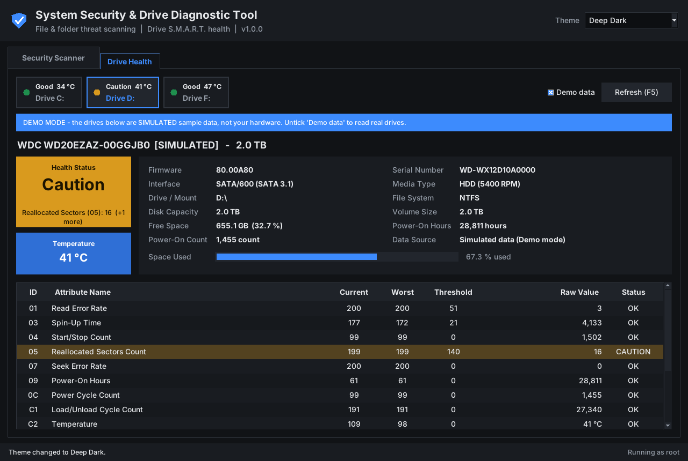
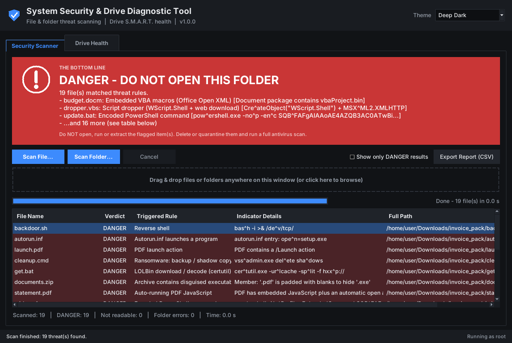
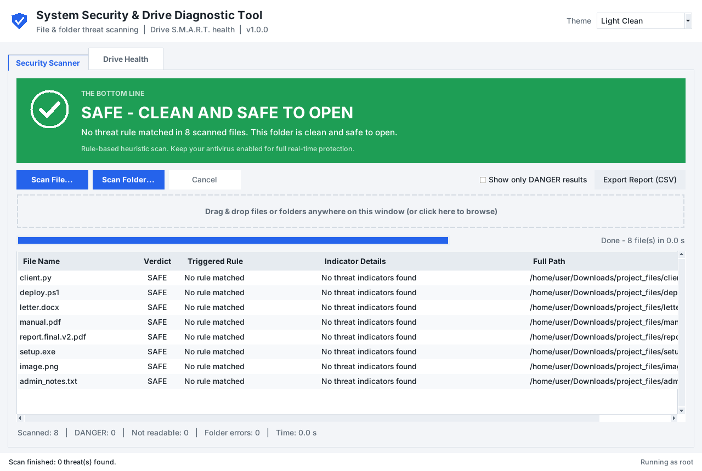

# System-Diagnostic-Tool

# System Security & Drive Diagnostic Tool

A Python desktop app that checks if files and folders are safe to open, and shows the health of your storage drives.

## Features

- Scan a single file or a whole folder
- Drag and drop support
- Clear SAFE (green) or DANGER (red) verdict
- Results table with the rule and pattern that was detected
- Drive health monitoring 
- Caution warning for Reallocated Sectors (05) and Pending Sectors (C5)
- 5 themes: Deep Dark, Cyber Blue, Nord Slate, Light Clean, Midnight Amber

## Screenshots

### 💾 Drive S.M.A.R.T. Health & Hardware Diagnostics


- **Interface:** Direct hardware health inspection featuring real-time temperature, drive status badges, capacity, power-on hours, and total read/write statistics.
- **Multi-Drive Navigation Bar:** Quick switcher tabs at the top allowing seamless toggling between multiple physical and logical drives (e.g., Drive C:, D:, F:).
- **In-Depth S.M.A.R.T. Attributes Table:** Displays critical low-level health parameters, highlighting warnings on reallocated sectors (ID 05), pending sectors, and temperature thresholds.
- **Built-in Demo Mode:** Includes a simulated hardware test suite (`Demo data`) to verify warning behaviors and inspect abnormal drive profiles safely.


### ⛔ Rule-Based Threat Scanner — Threat Detected (DANGER)


- **The Bottom Line Verdict:** Instant visual banner warning users **NOT** to open or run the target folder/file, summarizing confirmed threat counts.
- **Granular Detection Breakdown:** Detailed list of matched threat types including obfuscated scripts (`.vbs`, `.bat`), weaponized macros (`.docm`), LOLBins, reverse shells, and malicious archives.
- **Interactive Inspection Table:** Displays exact filename, triggered security rule, matched byte patterns/indicators, and absolute system path.
- **Report Export & Filtering:** Includes a quick toggle to `Show only DANGER results` and an `Export Report (CSV)` button for offline incident reviews.


### ✅ File & Directory Inspection — Clean Verdict (SAFE)


- **Clear Safety Status:** Prominent green verdict card confirming the scanned directory is safe to open, with 0 threat patterns identified.
- **Recursive Directory Inspection:** High-speed traversal capable of checking hundreds of files and nested directories in fractions of a second.
- **Transparent Audit Results:** Displays individual file inspection entries with `SAFE` verdicts, confirming that no malicious indicators or obfuscated extensions were matched.
- **Zero False Positives:** Built-in self-exclusion logic ensures security tools and rule definition files are never falsely flagged during system audits.


### 🎨 Fully Cohesive Theme Engine


- **5 Handcrafted Color Themes:** Includes `Deep Dark`, `Cyber Blue`, `Nord Slate`, `Light Clean`, and `Midnight Amber`.
- **Complete Visual Consistency:** The selected theme dynamically styles every widget, window background, header banner, button, and table row across both tabs without color bleeding.
- **Persistent Preferences:** The active theme is automatically preserved across application sessions.


## How to Run

```
pip install -r requirements.txt
python system_diagnostic_tool.py
```

Run as Administrator to read drive health data.

## Note

This is a rule-based scanner. It does not replace your antivirus.

## Author

OSAMAH ALBAWRAJI
